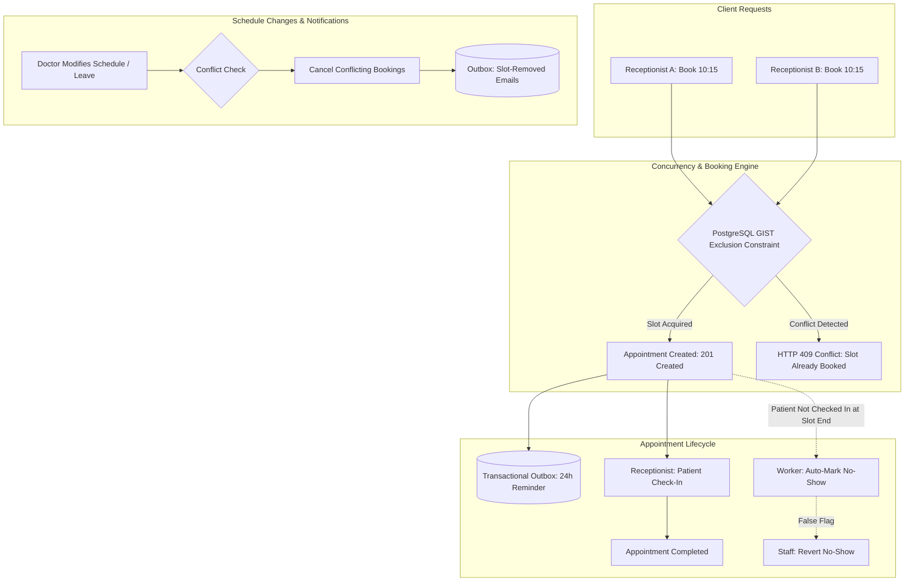

# Hospital Management System (HMS) — Appointment Scheduling Engine
## Technical Implementation Plan

## Goal Description
Build a production-grade, concurrent appointment scheduling engine in Go using Gin and PostgreSQL (`pgx` + `sqlc`). Designed to demonstrate senior-level backend engineering depth, the project focuses exclusively on the complex challenges of healthcare appointment scheduling:
1. **Concurrent appointment booking with zero double-booking** under race conditions.
2. **Doctor weekly office hours, time-off management, and dynamic 15-minute slot projection** (no database slot bloat).
3. **Strict appointment lifecycle state machine** (Booked, Checked-in, Completed, Cancelled, No-Show) with walk-in support, cancellation cutoffs, and no-show reconciliation.
4. **Crash-resilient background notifications** (24h reminders, slot removal alerts, and account invites) backed by a PostgreSQL **transactional outbox pattern** using `SELECT ... FOR UPDATE SKIP LOCKED`.
5. **Comprehensive audit trail & RBAC** tracking schedule adjustments, cancellations, and account governance.

---

## 1. Project Folder Structure

A modular, layered Go architecture separating HTTP transport (Gin), domain business logic, database queries (`sqlc`), and asynchronous background workers:

```text
HMS/
├── cmd/
│   ├── server/
│   │   └── main.go                 # HTTP API server entrypoint (config, DB pool, router, graceful shutdown)
│   ├── worker/
│   │   └── main.go                 # Background worker daemon (outbox dispatcher, 24h reminders, no-show sweeps)
│   └── seed/
│       └── main.go                 # CLI tool to seed root admin, sample departments, and initial test accounts
├── docs/                           # Requirements, ER diagrams, and architecture documentation
│   ├── Hospital Management System Project Requirements.md
│   └── hms_schema_full_er_diagram_readable_headers.html
├── internal/
│   ├── api/                        # HTTP transport layer (Gin)
│   │   ├── handler/                # Route handlers (translates JSON requests/responses, calls services)
│   │   │   ├── auth_handler.go     # Login, token refresh, logout, invite claim & verification
│   │   │   ├── admin_handler.go    # Staff invites, account deactivation, department CRUD
│   │   │   ├── doctor_handler.go   # Weekly office hours, time-off, schedule queries
│   │   │   ├── patient_handler.go  # Patient registration (receptionist), demographic lookups
│   │   │   ├── appointment_handler.go # Slot lookup, concurrent booking, check-in, cancellations, no-show reverts
│   │   │   └── audit_handler.go    # Audit trail inspection (schedule updates, cancellations, account actions)
│   │   ├── middleware/             # Gin middlewares
│   │   │   ├── auth.go             # JWT verification, session extraction, context injection
│   │   │   ├── rbac.go             # Role-based access control (Admin, Doctor, Receptionist, Patient)
│   │   │   ├── audit.go            # Audit logging for sensitive scheduling actions
│   │   │   ├── recovery.go         # Panic recovery returning structured JSON errors
│   │   │   └── request_id.go       # Correlation ID injection for request tracing
│   │   ├── response/               # Standardized JSON response envelope and error mapping helpers
│   │   │   └── response.go
│   │   └── router.go               # Gin engine setup, route groups, and middleware pipelines
│   ├── config/                     # Environment configuration parsing and validation
│   │   └── config.go
│   ├── db/                         # Database persistence layer
│   │   ├── migrations/             # Goose SQL migration files (schema definitions, constraints, indexes)
│   │   ├── queries/                # sqlc raw SQL query definitions (*.sql)
│   │   ├── tx.go                   # Transaction manager helper for pgxpool
│   │   └── *.sql.go                # sqlc generated type-safe queries, models, and interfaces
│   ├── domain/                     # Core business models, enums, domain invariants, and sentinel errors
│   │   ├── account.go              # Account model, user roles (Admin, Doctor, Receptionist, Patient)
│   │   ├── appointment.go          # Appointment model, status enums, cancellation reasons
│   │   ├── errors.go               # Sentinel errors (ErrSlotAlreadyBooked, ErrCancellationCutoff, etc.)
│   │   └── notification.go         # Outbox notification entity and event types
│   ├── mailer/                     # Email delivery abstraction
│   │   ├── mailer.go               # Mailer interface (SendInvite, SendReminder, SendSlotRemoved)
│   │   ├── smtp.go                 # Production SMTP client
│   │   └── mock.go                 # In-memory mock mailer for automated testing
│   ├── service/                    # Business logic orchestration layer
│   │   ├── auth_service.go         # Password hashing, JWT issuance, invite verification & claiming
│   │   ├── account_service.go      # Account provisioning, staff deactivation, department management
│   │   ├── schedule_service.go     # Office hours, time-off, dynamic 15-minute slot projection
│   │   ├── appointment_service.go  # Booking engine, exclusion check, state machine transitions, cancellations
│   │   ├── audit_service.go        # Append-only audit logger and query service
│   │   └── notification_service.go # Outbox enqueueing, retry policy, template rendering
│   └── worker/                     # Asynchronous background job processing
│       ├── dispatcher.go           # Outbox processor polling with SELECT ... FOR UPDATE SKIP LOCKED
│       ├── reminder_job.go         # 24-hour appointment reminder scheduler
│       └── no_show_job.go          # Periodic background sweep marking unattended appointments as no-show
├── plan/
│   └── technical_implementation_plan.md
├── tests/                          # Integration and concurrency test suites
│   ├── concurrency/
│   │   └── booking_concurrency_test.go # High-concurrency slot booking benchmark (goroutine race tests)
│   ├── integration/                # End-to-end API test suites against isolated test DB
│   └── testutil/                   # Test fixtures, database container setup, mock auth tokens
├── Makefile                        # Automation recipes: migrate, sqlc, test, run, build
├── go.mod
├── go.sum
└── sqlc.yaml                       # sqlc code generation configuration
```

---

## 2. API Endpoints Specification

All backend endpoints are mounted under `/api/v1` and use standard HTTP verbs and status codes. Responses follow a uniform JSON structure:
- **Success:** `{ "success": true, "data": { ... } }`
- **Error:** `{ "success": false, "error": { "code": "SLOT_CONFLICT", "message": "The selected time slot has already been booked" } }`

### 2.1 Authentication & Onboarding
| Method | Endpoint | Allowed Roles | Description |
| :--- | :--- | :--- | :--- |
| `POST` | `/api/v1/auth/login` | Public | Authenticates via email/password; returns JWT access token + refresh token |
| `POST` | `/api/v1/auth/refresh` | Public | Refreshes expired access token using valid refresh token |
| `POST` | `/api/v1/auth/logout` | Authenticated | Revokes active session/refresh token |
| `GET` | `/api/v1/auth/invite/verify` | Public | Validates an invite token and returns prefilled email and role |
| `POST` | `/api/v1/auth/invite/claim` | Public | Sets password and activates account for invited staff or patient |
| `GET` | `/api/v1/auth/me` | Authenticated | Returns authenticated user identity, role, and profile |

### 2.2 Admin & Staff Governance
| Method | Endpoint | Allowed Roles | Description |
| :--- | :--- | :--- | :--- |
| `POST` | `/api/v1/admin/invites` | Admin | Invites new staff member (Doctor, Receptionist, Admin); enqueues invite email |
| `GET` | `/api/v1/admin/accounts` | Admin | Lists accounts with pagination and filters (`role`, `status`) |
| `POST` | `/api/v1/admin/accounts/{id}/deactivate` | Admin | Deactivates departing staff (never deleted; immediately revokes login access) |
| `GET` | `/api/v1/admin/departments` | Admin, Receptionist | Lists all clinical departments |
| `POST` | `/api/v1/admin/departments` | Admin | Creates a new department |
| `PUT` | `/api/v1/admin/departments/{id}` | Admin | Updates department name/info |
| `GET` | `/api/v1/admin/audit-logs` | Admin | Queries administrative audit events (account actions, schedule updates) |

### 2.3 Patient Registration & Demographics
| Method | Endpoint | Allowed Roles | Description |
| :--- | :--- | :--- | :--- |
| `POST` | `/api/v1/receptionist/patients` | Receptionist | Registers patient with email, DOB, contact; triggers patient invite email |
| `GET` | `/api/v1/patients` | Receptionist, Doctor | Searches/lists patients by name, email, or phone number |
| `GET` | `/api/v1/patients/{id}` | Receptionist, Doctor, Patient (self) | Retrieves patient demographic and contact details |

### 2.4 Doctor Schedules & Availability
| Method | Endpoint | Allowed Roles | Description |
| :--- | :--- | :--- | :--- |
| `GET` | `/api/v1/doctors` | All roles | Lists active doctors with department filter |
| `GET` | `/api/v1/doctors/{id}/schedule` | All roles | Gets doctor's weekly office hours and scheduled leave ranges |
| `PUT` | `/api/v1/doctors/{id}/office-hours` | Doctor (self), Admin | Updates recurring weekly schedule; preview mode checks conflicting bookings |
| `POST` | `/api/v1/doctors/{id}/time-off` | Doctor (self), Admin | Books time-off/leave; cancels affected booked slots and triggers alerts |
| `GET` | `/api/v1/doctors/{id}/available-slots` | Receptionist, Doctor, Patient | Computes discrete available 15-minute slots for the upcoming 7 days |

### 2.5 Appointments Lifecycle
| Method | Endpoint | Allowed Roles | Description |
| :--- | :--- | :--- | :--- |
| `POST` | `/api/v1/appointments` | Receptionist | Books a 15-minute slot for a patient. Protected by database exclusion locks |
| `GET` | `/api/v1/appointments` | Receptionist (all), Doctor (own), Patient (own) | Lists appointments filtered by date range, doctor, patient, status |
| `GET` | `/api/v1/appointments/{id}` | Receptionist, Assigned Doctor, Patient (self) | Gets appointment status, timestamps, and metadata |
| `POST` | `/api/v1/appointments/{id}/check-in` | Receptionist | Checks in patient upon arrival (moves status `booked -> checked_in`) |
| `POST` | `/api/v1/appointments/{id}/complete` | Doctor, Receptionist | Marks consultation complete (`checked_in -> completed`) |
| `POST` | `/api/v1/appointments/{id}/cancel` | Patient (up to 1h prior), Receptionist/Doctor/Admin (any time) | Cancels booking with reason; revokes pending reminder in outbox |
| `POST` | `/api/v1/appointments/{id}/revert-no-show` | Receptionist, Assigned Doctor | Reverts an incorrect auto-marked no-show back to checked-in |
| `GET` | `/api/v1/appointments/{id}/history` | Receptionist, Doctor, Patient (self) | Returns state transition timeline (`booked -> checked_in -> ...`) |

---

## 3. Core Technical Challenges & Engineering Solutions



### Challenge 1: Zero Double-Booking Under High Concurrency
- **The Challenge:** Two staff members booking the exact same 15-minute slot for a doctor at the same millisecond, or rebooking a slot freed by a sudden cancellation.
- **The Solution:**
  1. We enforce an atomic database constraint using PostgreSQL range types and `btree_gist`:
     ```sql
     CREATE EXTENSION IF NOT EXISTS btree_gist;

     ALTER TABLE appointments 
     ADD CONSTRAINT no_overlapping_doctor_appointments 
     EXCLUDE USING gist (
       doctor_id WITH =,
       tstzrange(starts_at, ends_at) WITH &&
     ) WHERE (status NOT IN ('cancelled'));
     ```
  2. Any concurrent booking attempt trying to occupy the same time range for the same doctor raises PostgreSQL error `23P01` (`exclusion_violation`).
  3. The Go service catches `23P01`, maps it to `domain.ErrSlotAlreadyBooked`, and returns `409 Conflict` with a clear explanation.
  4. **Verification:** Concurrency integration test (`tests/concurrency/booking_concurrency_test.go`) fires 50 concurrent goroutines attempting to book the identical slot; exactly 1 receives `201 Created` and 49 receive `409 Conflict`.

### Challenge 2: Dynamic 15-Minute Slot Generation (Zero Slot Bloat)
- **The Challenge:** Pre-generating and storing empty slot records for every 15 minutes of every doctor for months causes massive database bloat and difficult sync logic when hours change.
- **The Solution:**
  1. **Dynamic Interval Projection:** Slots are computed in-memory on demand:
     - Load doctor's weekly recurring office hours for the requested day of the week.
     - Slice office hour windows into discrete 15-minute intervals.
     - Subtract any interval intersecting with `doctor_time_off`.
     - Subtract any interval already occupied by active appointments (`status NOT IN ('cancelled')`).
     - Filter out intervals in the past (allowing walk-in bookings for current active 15-minute slot).
  2. **Booking Window:** The service restricts booking to within 1 week in advance.

### Challenge 3: Schedule Changes & Conflict Resolution
- **The Challenge:** When a doctor updates office hours or logs one-off leave, appointments already booked during those removed hours become invalid and must be safely cancelled, alerting the patients.
- **The Solution:**
  1. **Preview Mode:** `PUT /api/v1/doctors/{id}/office-hours?preview=true` scans for existing booked appointments outside the proposed hours and returns the list to the doctor for confirmation.
  2. **Atomic Cancellation & Notification:**
     - In a single database transaction:
       - Update office hours or insert `doctor_time_off`.
       - Query all appointments falling in the invalid window with `status = 'booked'`.
       - Update their status to `'cancelled'`, setting `cancellation_reason = 'doctor_schedule_change'`.
       - Insert `'slot_removed'` notification rows into the transactional outbox table for all affected patients.

### Challenge 4: Reliable Background Work & Transactional Outbox Pattern
- **The Challenge:** In-memory timers fail on server crashes. 24-hour reminder emails must survive restarts, retry on SMTP errors, and be cancelled immediately if an appointment is cancelled. Automated no-show sweeps must run reliably.
- **The Solution:**
  1. **Transactional Outbox Table (`notifications`):**
     - When booking >24h ahead, a notification row is written in the **exact same database transaction** as the appointment:
       ```sql
       INSERT INTO notifications (recipient_id, appointment_id, type, scheduled_for, status)
       VALUES ($1, $2, 'appointment_reminder', $starts_at - INTERVAL '24 hours', 'pending');
       ```
  2. **Atomic Cancellation:** Cancelling an appointment updates the outbox row inside the cancellation transaction:
     ```sql
     UPDATE notifications 
     SET status = 'cancelled' 
     WHERE appointment_id = $1 AND status = 'pending';
     ```
  3. **Safe Worker Polling with `SKIP LOCKED`:**
     ```sql
     SELECT id, recipient_id, type, scheduled_for 
     FROM notifications
     WHERE status = 'pending' AND scheduled_for <= NOW()
     ORDER BY scheduled_for ASC
     LIMIT 10
     FOR UPDATE SKIP LOCKED;
     ```
     Enables running multiple background worker replicas without duplicate email delivery.
  4. **Automated No-Show Sweep:**
     - A background cron worker periodically scans for appointments where `ends_at <= NOW()` and `status = 'booked'`.
     - Automatically updates status to `'no_show'`.
     - Provides a revert endpoint (`POST /api/v1/appointments/{id}/revert-no-show`) if a receptionist or doctor confirms the patient was present.

### Challenge 5: Cancellation Rules & Walk-in Immediate Check-in
- **The Challenge:** Enforcing fine-grained business invariants:
  - Patients can only cancel up to 1 hour before the slot starts.
  - Staff (receptionist, doctor, admin) can cancel at any time.
  - Walk-in appointments booked during an ongoing slot must be checked in immediately.
- **The Solution:**
  - Evaluated in `appointment_service.go`:
    ```go
    if caller.Role == domain.RolePatient {
        if time.Until(appt.StartsAt) < 1*time.Hour {
            return domain.ErrCancellationCutoffExceeded
        }
    }
    ```
  - For walk-ins: If `time.Now()` is between `starts_at` and `ends_at`, the booking transaction immediately marks status as `checked_in`.

---

## 4. Verification & Testing Strategy

### 4.1 Automated Concurrency Tests
- **Command:** `go test -v -race ./tests/concurrency -run TestConcurrentSlotBooking`
- **Methodology:** 50 parallel goroutines simulate concurrent booking requests for the same doctor and slot. Asserts that exactly 1 returns HTTP `201 Created` and 49 return HTTP `409 Conflict`.

### 4.2 Lifecycle & Outbox Integration Tests
- **Command:** `go test -v ./tests/integration -run TestAppointmentLifecycleAndOutbox`
- **Methodology:**
  - Books appointment >24h ahead -> verifies `notifications` row created with `status = 'pending'`.
  - Cancels appointment -> verifies `notifications` row updated to `status = 'cancelled'`.
  - Simulates schedule change -> verifies affected bookings cancelled and `'slot_removed'` emails enqueued.
  - Tests 1-hour patient cancellation rule rejection.
